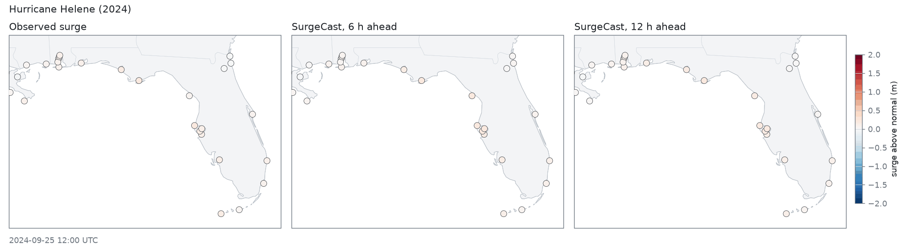
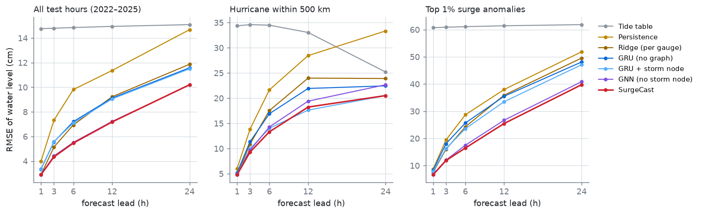
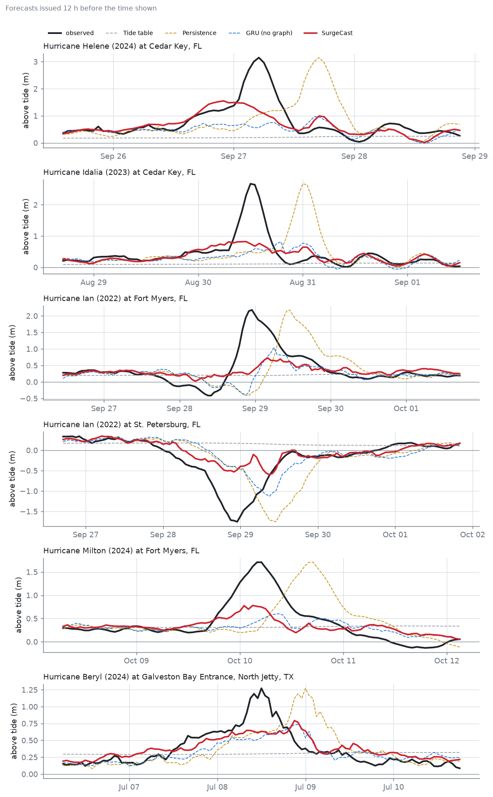
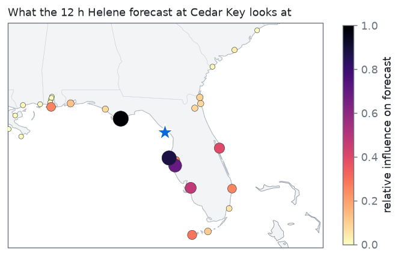
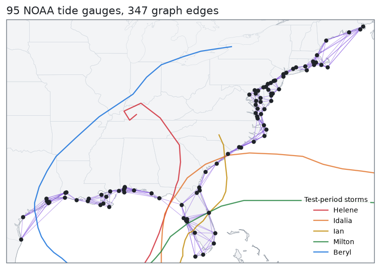
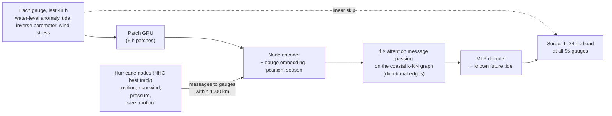

# SurgeCast

**A graph neural network that forecasts hurricane storm surge 1–24 hours ahead
across NOAA's tide-gauge network on the US Atlantic and Gulf coasts.**

Every NOAA tide gauge is a node. Every active hurricane is a moving node that
sends messages to the gauges around it. The model reads the last 48 hours of
water level, air pressure and wind at each gauge, passes information along the
coast, and predicts how far the sea will rise above the tide table at every
gauge for each of the next 24 hours.

It trains on 2008–2020, picks hyperparameters on 2021, and is scored on
2022–2025: Ian, Idalia, Helene, Milton, Beryl and more storms it never saw
during training.



*Hurricane Helene's landfall in Florida's Big Bend, September 2024. Left: the
observed surge at each gauge. Middle and right: what SurgeCast forecast for
that same hour, 6 and 12 hours earlier. Helene was never in the training data.*

## Results

Scored on every hour of 2022–2025 at all 95 gauges and all 24 leads: 80
million forecasts. Error is the RMSE of water level above the tide table, in
centimetres, averaged over leads of 1–24 h.

| Model | All hours | Hurricane within 500 km | Top 1% surges |
|---|---:|---:|---:|
| Tide table | 14.9 | 31.8 | 61.4 |
| Persistence | 11.9 | 27.6 | 39.3 |
| Ridge regression per gauge | 9.2 | 21.7 | 36.6 |
| **SurgeCast** | **7.5** | **17.0** | **27.1** |
| *vs. ridge* | *−19%* | *−22%* | *−26%* |



### What each idea contributes

A 2 × 2 ablation, everything else held fixed:

| | All hours | Hurricane within 500 km | Top 1% surges |
|---|---:|---:|---:|
| GRU per gauge (no graph, no storm node) | 9.1 | 20.2 | 35.9 |
| + storm node | 9.1 | **17.0** | 34.2 |
| + graph | **7.5** | 18.5 | 28.0 |
| + both (SurgeCast) | **7.5** | **17.0** | **27.1** |

- **The graph** carries most of the gain overall and on the largest surges
  (35.9 → 28.0 cm). A gauge's neighbours know about surge that is already
  travelling along the coast, which no single-gauge model can see.
- **The storm node** carries the gain in hurricane hours (20.2 → 17.0 cm). It
  tells each gauge about a storm before the gauge's own barometer and
  anemometer feel it.
- **Together** they are best or tied on every subset. Not at every lead:
  12 h ahead in hurricane hours the GRU with a storm node is slightly better
  (17.6 vs 18.2 cm). Each model is a single training run, so differences
  under about half a centimetre are noise.

Per-lead tables for every model are in [results/metrics.md](results/metrics.md).

### Landfalls it never saw



Forecast at the hour of the observed peak, issued 3, 6 and 12 h earlier:

| Storm | Gauge | Observed | 3 h ahead | 6 h ahead | 12 h ahead |
|---|---|---:|---:|---:|---:|
| Helene 2024 | Cedar Key, FL | +3.15 m | +2.37 | +1.56 | +1.17 |
| Idalia 2023 | Cedar Key, FL | +2.67 m | +1.66 | +1.52 | +0.75 |
| Ian 2022 | Fort Myers, FL | +2.18 m | +1.32 | +0.64 | +0.31 |
| Ian 2022 | St. Petersburg, FL | −1.75 m | −1.57 | −1.00 | −0.48 |
| Milton 2024 | Fort Myers, FL | +1.71 m | +1.17 | +0.64 | +0.75 |
| Beryl 2024 | Galveston Bay Entrance, TX | +1.27 m | +1.18 | +0.75 | +0.63 |

SurgeCast gets the sign and the timing right, including Ian pushing water
*out* of Tampa Bay at St. Petersburg while it flooded Fort Myers 145 km south.
The size of the peak is another matter: it forecasts 61–93% of the peak 3 h
ahead but only 14–50% at 12 h, because it has no forecast winds and does not
know where the storm will be 12 h later. On single peak hours no model wins
every case. The per-gauge ridge is often closer 1–3 h ahead, and the GRU with
a storm node is often closer at 12 h. Averaged over all hurricane and extreme
hours, SurgeCast matches or beats every other model.

### What the forecast looks at



Gradient × input for the 12 h forecast at Cedar Key (★), issued while Helene
was still in the Gulf, about 380 km away. Leaving out Cedar Key's own history,
the model leans hardest on Apalachicola, which lies ahead of the storm, and on
the Tampa Bay gauges (Clearwater Beach, Port Manatee) on its right side, where
onshore wind was already piling up water. Nothing in the architecture says
which gauges matter; this pattern comes from training.



## How it works



**Target.** NOAA publishes a harmonic tide prediction for every gauge.
Observed water level minus that prediction is the *non-tidal residual*, where
storm surge lives. The model predicts the change in residual over the next
1–24 h, normalised per gauge, so slow signals such as seasonal sea level and
sea-level rise cancel out.

**Physics in the inputs.** Raw barometer and anemometer readings are turned
into the quantities that actually move water: the inverse-barometer rise
(about 1 cm per hPa of pressure drop) and wind stress τ = ρ C_d |U| U, with a
drag coefficient that saturates in hurricane-force wind. The decoder is told
the future astronomical tide at every lead, since surge and tide interact in
shallow water. [docs/physics.md](docs/physics.md) has the full reasoning.

**Graph.** Gauges are linked to their 6 nearest neighbours by great-circle
distance (347 undirected edges). Each edge carries the sender's east/north
offset, so attention can treat upstream and downstream neighbours differently.
Surge travels along the shelf as coastally trapped waves, so a gauge up the
coast often sees it hours earlier.

**Hurricane nodes.** A gauge's own instruments only see a hurricane once it
is close, and they often fail at landfall. Each active Atlantic storm becomes
an extra node carrying its NHC best-track state at forecast time, plus its
motion over the previous 6 h. It messages every gauge within 1000 km, with
edge features giving its distance and bearing from that gauge. The model never
sees where the storm goes next.

**Message passing** is written from scratch in PyTorch (segment softmax over
incoming edges, `index_add` aggregation, interaction-network-style edge
updates), with no graph library dependency. 741k parameters.

## Evaluation

- **Splits by year:** train 2008–2020, validation 2021, test 2022–2025.
  Forecast windows never cross a split, and every input is causal (gap-fill of
  at most 2 h, trailing 30-day mean).
- **Baselines:** the tide table alone (plus the 30-day mean anomaly),
  persistence of the current anomaly, and a ridge regression per gauge on the
  same inputs, with its penalty picked on 2021.
- **Ablation:** a 2 × 2 over the two ideas: graph on/off and hurricane nodes
  on/off. Turning the graph off keeps the model identical except that
  neighbour messages are zeroed, so each gauge is forecast on its own.
- **Scored on three subsets:** all test hours, hours with a hurricane within
  500 km of the gauge at forecast time, and the top 1% of surge anomalies
  (above each gauge's 99th percentile in the training years).

## Data

| Source | What | Used for |
|---|---|---|
| [NOAA CO-OPS](https://api.tidesandcurrents.noaa.gov/api/prod/) | hourly water level, tide predictions, air pressure, wind at 95 gauges, 2008–2025 | inputs and targets |
| [NHC HURDAT2](https://www.nhc.noaa.gov/data/#hurdat) | 6-hourly Atlantic best tracks | hurricane nodes |

Gauges are kept if they are tidal, on the Atlantic or Gulf coast between
Texas and Maine, and have at least 80% water-level coverage over 2008–2025.

## Repository layout

```
src/surgecast/
  noaa.py       NOAA CO-OPS client (rate-limited, cached, resumable) and HURDAT2 download
  physics.py    inverse barometer, drag coefficient, wind stress, great-circle geometry
  storms.py     HURDAT2 parser, hourly storm states relative to the gauge network
  dataset.py    QC, causal features, normalisation, on-device batching
  graph.py      k-NN gauge graph and directional edge features
  layers.py     segment softmax, attention message-passing layer
  model.py      SurgeCast: encoder, storm encoder, processor, decoder
  train.py      training loop with event oversampling and checkpoint/resume
  evaluate.py   baselines, test-set metrics, ablation tables
  viz.py        maps, skill curves, case studies, animation
scripts/        download, build dataset, make figures, run everything
configs/        model and training settings
docs/physics.md the physics behind the inputs and the architecture
tests/          unit tests for physics, graph, layers and dataset
```

## Reproduce

```bash
uv venv --python 3.12 && source .venv/bin/activate
uv pip install -e ".[maps,dev]"
bash scripts/run_experiments.sh      # download -> build -> train 4 models -> evaluate -> figures
pytest -q                            # unit tests (no data needed)
```

The download is about 7,000 requests to the NOAA API, rate-limited to 2 per
second, and takes about an hour. On a single Apple M4 (16 GB) with the PyTorch
MPS backend, each graph model trains in about 45 minutes and each model
without the graph in about 13.

## Limitations

- **Observations only.** Operational systems (NOAA P-Surge with SLOSH, ESTOFS
  with ADCIRC) solve the shallow-water equations forced by *forecast* winds.
  SurgeCast sees only what has already happened, which is why it captures
  only 14–50% of landfall peaks 12 h ahead. Adding forecast wind fields (for
  example GFS) or the NHC forecast track is the obvious next step.
- **Conservative on extremes.** A mean-squared-error loss on rare events pulls
  forecasts toward the middle. Event oversampling helps but doesn't remove it;
  a quantile or tail-weighted loss is worth trying.
- **Overfits early.** Validation loss bottoms out between epochs 4 and 9 of
  30, and the best checkpoint is kept. More data (more gauges, earlier years)
  or stronger regularisation would likely help more than a bigger model.
- **Best tracks, not advisories.** HURDAT2 is a post-season reanalysis, a bit
  cleaner than the advisories available in real time.
- **Gauges fail in the worst storms.** Several gauges stop reporting near
  landfall, so the most extreme hours are under-represented in both training
  and scoring.
- **One seed per model.** Differences of a few tenths of a centimetre between
  models are within run-to-run noise.

## License

MIT
